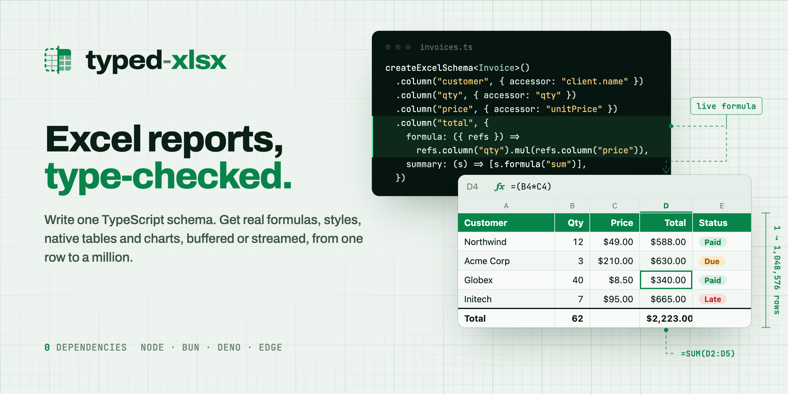
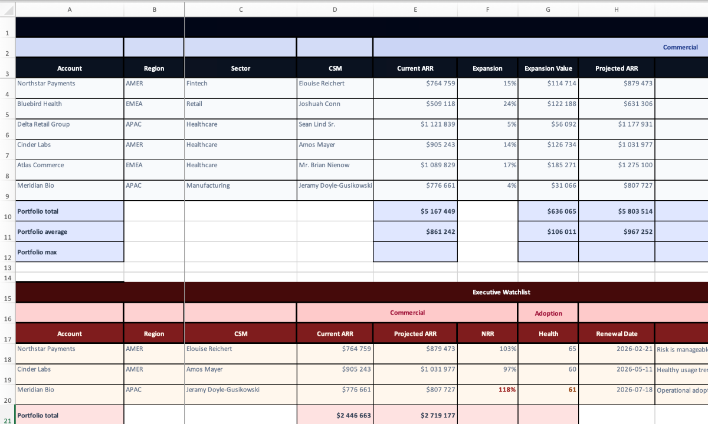
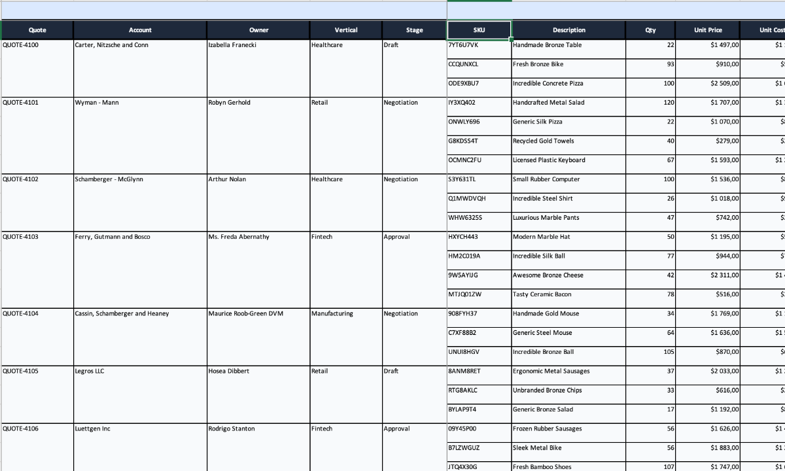
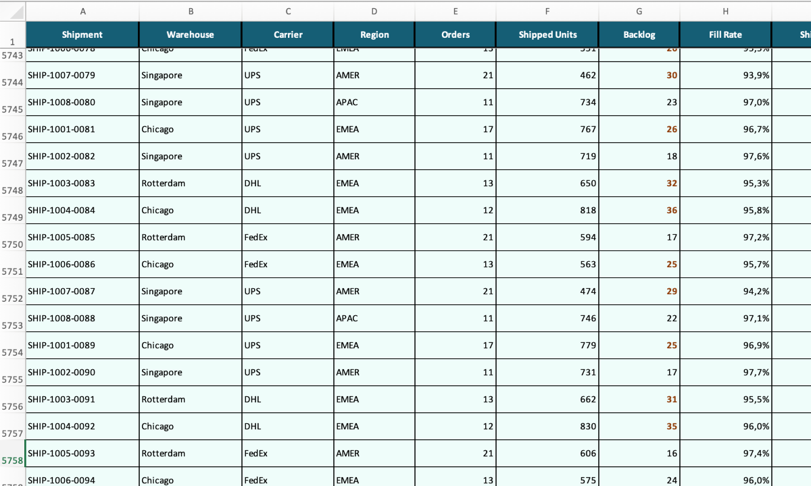
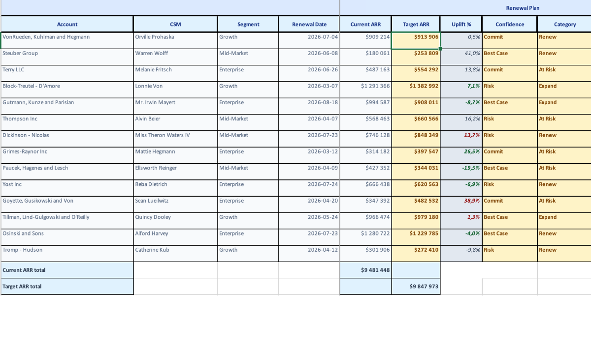

<p align="center">
  <a href="https://typed-xlsx.vercel.app">
    <picture>
      <source media="(prefers-color-scheme: dark)" srcset="./.github/assets/banner-dark.png" />
      
    </picture>
  </a>
</p>

<p align="center">
  <a href="https://npmjs.com/package/typed-xlsx"></a>
  <a href="https://npmjs.com/package/typed-xlsx"></a>
  <a href="https://bundlephobia.com/result?p=typed-xlsx"></a>
  
  <a href="./LICENSE"></a>
</p>

<p align="center">
  <a href="https://typed-xlsx.vercel.app/getting-started/quick-start"><b>Quick start</b></a>
  &nbsp;·&nbsp;
  <a href="https://typed-xlsx.vercel.app/playground">Playground</a>
  &nbsp;·&nbsp;
  <a href="https://typed-xlsx.vercel.app/getting-started/comparison">vs ExcelJS and SheetJS</a>
  &nbsp;·&nbsp;
  <a href="https://typed-xlsx.vercel.app">Docs</a>
</p>

<br />

Most spreadsheet libraries hand you cells. **typed-xlsx hands you a schema.** You describe each column once, against your own TypeScript type. The library writes the workbook: headers, styles, real Excel formulas, totals and native tables. If a column or a formula points at something that doesn't exist, the compiler stops you before anyone opens the file.

```bash
npm install typed-xlsx
```

Also on pnpm, yarn and bun. It runs on Node.js, Bun, Deno and edge runtimes, with zero runtime dependencies. Actively maintained since 2023 and versioned with semver: 4.x is the current major.

## A report in one schema

```ts
import { createExcelSchema, createWorkbook } from "typed-xlsx";

type Invoice = {
  id: string;
  customer: { name: string };
  qty: number;
  unitPrice: number;
  status: "paid" | "due" | "late";
};

const money = { numFmt: "$#,##0.00" };

const invoices = createExcelSchema<Invoice>()
  .column("id", { header: "Invoice #", accessor: "id" })
  .column("customer", { header: "Customer", accessor: "customer.name" })
  .column("qty", { header: "Qty", accessor: "qty" })
  .column("price", { header: "Unit price", accessor: "unitPrice", style: money })
  .column("total", {
    header: "Total",
    formula: ({ refs }) => refs.column("qty").mul(refs.column("price")), // written as =(C2*D2)
    style: money,
    summary: (s) => [s.formula("sum")], // a SUM row under the data
  })
  .column("status", {
    header: "Status",
    type: "badge",
    accessor: "status",
    variants: {
      paid: { style: { fill: { color: { rgb: "DCFCE7" } } } },
      due: { style: { fill: { color: { rgb: "FEF3C7" } } } },
      late: { style: { fill: { color: { rgb: "FEE2E2" } } } },
    },
  })
  .build();

const rows: Invoice[] = [
  { id: "INV-001", customer: { name: "Acme Corp" }, qty: 3, unitPrice: 210, status: "due" },
  { id: "INV-002", customer: { name: "Globex" }, qty: 40, unitPrice: 8.5, status: "paid" },
];

const workbook = createWorkbook();
workbook
  .sheet("Invoices", { freezePane: { rows: 1 } })
  .table("invoices", { rows, schema: invoices });

await workbook.writeToFile("./invoices.xlsx"); // or toBuffer() for an HTTP response
```

`accessor: "customer.nam"` and `refs.column("totl")` are both type errors. The `Total` column is a live formula, so it recalculates when someone edits a quantity in Excel.

## Same schema, any size

Load the rows into memory and call `createWorkbook()`. When they come from a database cursor, swap the builder for `createWorkbookStream()` and keep the schema. Rows go out in batches through a 64 KiB spool to the library's own ZIP engine. Memory stays roughly flat as the file grows.

```ts
import { createWorkbookStream } from "typed-xlsx";

const workbook = createWorkbookStream();
const table = await workbook.sheet("Invoices").table("invoices", { schema: invoices });

for await (const batch of cursor) {
  await table.commit({ rows: batch });
}

await workbook.pipeToNode(response); // or writeToFile(), or a web ReadableStream
```

| Rows streamed |  Time | Peak memory (RSS) |
| ------------: | ----: | ----------------: |
|       200,000 | 3.7 s |           274 MiB |
|       500,000 | 9.3 s |           279 MiB |

These rows have 11 styled columns, written in 5,000-row batches with Node 24 on an Apple M5. 2.5× the rows cost 5 MiB more memory. See the [benchmark report](./packages/benchmark/artifacts/reports/stream/THROUGHPUT_2026-09-22.md) for the method and the cases that keep more in memory.

## What ends up in the file

- **Real formulas**, written from column references instead of cell addresses. Summary rows, conditional styles and formulas that work across sub-rows.
- **Native Excel tables**, with filters, a totals row, structured references like `[@Revenue]` and built-in table styles.
- **Charts and pivot tables** built from the tables you declared: bar, line, area, scatter, pie and combo charts. TypeScript only accepts numeric columns as values.
- **Rich cells**: badges, checkboxes, hyperlinks, sparklines and images, embedded or loaded from a URL.
- **Workbooks people can edit safely**: dropdowns and validation rules, locked formula columns, freeze panes and themes.
- **Reports that fit the data**: columns generated at runtime, grouped headers, and one record expanding into several rows.

## Real workbooks it generates

Each screenshot opens the full workbook in the playground, along with the code that built it.

<table>
  <tr>
    <td width="50%" valign="top">
      <a href="https://typed-xlsx.vercel.app/playground/executive-board-pack"></a>
      <br /><b>Executive board pack</b><br />Grouped headers, summary rows and several sheets.
    </td>
    <td width="50%" valign="top">
      <a href="https://typed-xlsx.vercel.app/playground/deal-desk-quote-review"></a>
      <br /><b>Deal desk quote review</b><br />One quote expands into its line items, without any row math.
    </td>
  </tr>
  <tr>
    <td width="50%" valign="top">
      <a href="https://typed-xlsx.vercel.app/playground/streaming-fulfillment-export"></a>
      <br /><b>Streaming fulfillment export</b><br />The same schema, committed in batches.
    </td>
    <td width="50%" valign="top">
      <a href="https://typed-xlsx.vercel.app/playground/renewal-ops-workbook"></a>
      <br /><b>Renewal ops workbook</b><br />Editable inputs, validation and locked formula columns.
    </td>
  </tr>
</table>

## Charts from your tables

```ts
createWorkbook()
  .sheet("2026")
  .table("sales", { schema: salesSchema, rows })
  .table("targets", { schema: targetSchema, rows: targetRows })
  .chart("performance", ({ refs }) => ({
    title: "Revenue vs target",
    marks: [
      refs.table("sales").bar({ x: "month", y: "revenue" }),
      refs.table("targets").line({ x: "month", y: "target", name: "Target" }),
    ],
  }));
```

Pivot tables work the same way: `refs.table("sales").pivot({ rows: ["region"], values: { revenue: "sum" } })`. They stay interactive in Excel, and a pivot chart can follow them. Read the [charts guide](https://typed-xlsx.vercel.app/charts/overview) and the [pivot tables guide](https://typed-xlsx.vercel.app/charts/pivot-tables).

## When to use something else

typed-xlsx **writes** `.xlsx` files from your data. It doesn't read them.

- To read, edit or convert existing spreadsheets, or to handle formats beyond `.xlsx`, use [SheetJS](https://sheetjs.com).
- To edit a workbook cell by cell, or to draw free-form shapes, use [ExcelJS](https://github.com/exceljs/exceljs).

The [comparison page](https://typed-xlsx.vercel.app/getting-started/comparison) goes through the trade-offs feature by feature.

## Using an AI assistant?

The docs come in a form agents can read. Give your assistant [`llms-full.txt`](https://typed-xlsx.vercel.app/llms-full.txt) to load the whole guide, or [`llms.txt`](https://typed-xlsx.vercel.app/llms.txt) for an index. Every page also exists as Markdown: add `.md` to its URL.

## Feedback

If you export something with typed-xlsx, I'd like to hear what it is, and what got in your way. [Open an issue](https://github.com/ChronicStone/typed-xlsx/issues/new/choose) for a bug, a missing feature or a quick note. Stars help other people find the project.

## License

[MIT](./LICENSE) © 2023-present [Cyprien Thao](https://github.com/ChronicStone)
