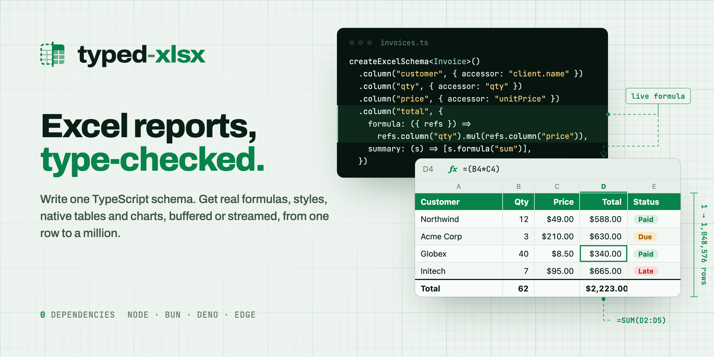
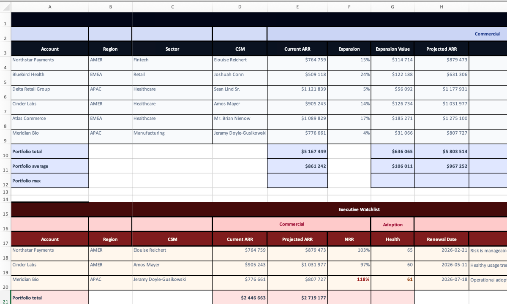
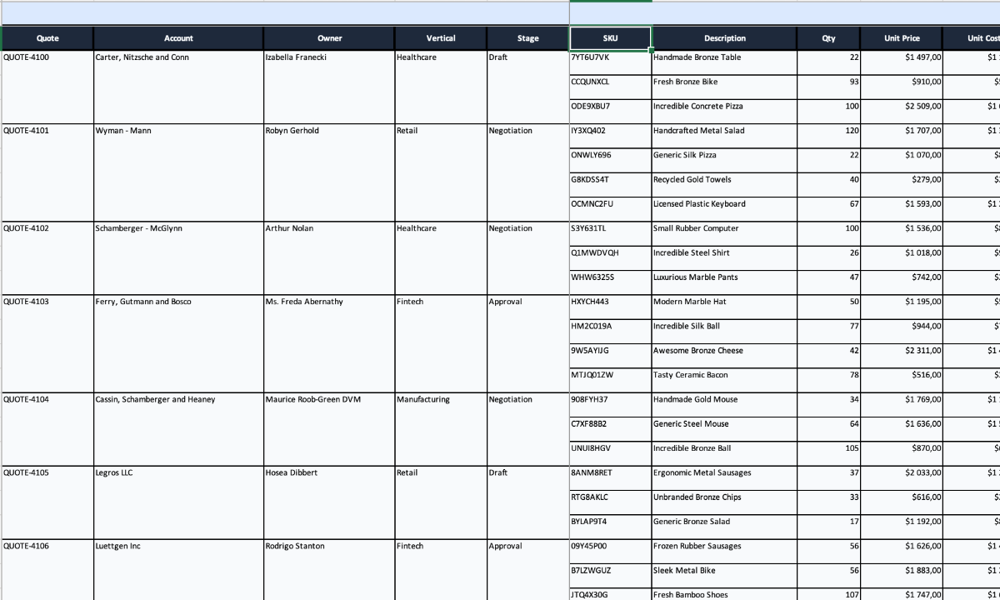
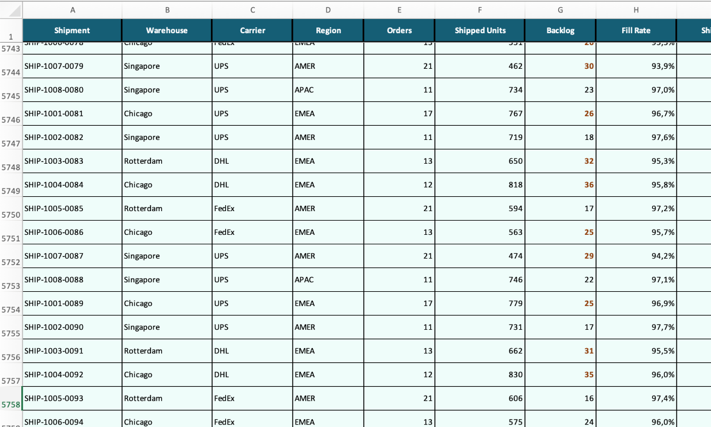
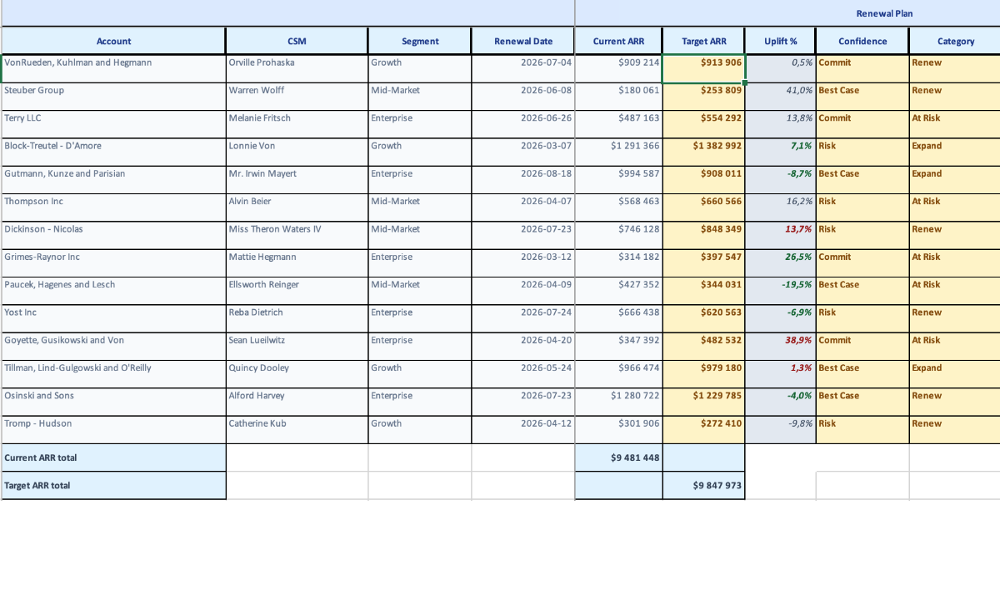

<p align="center">
  <a href="https://typed-xlsx.vercel.app">
    <picture>
      <source media="(prefers-color-scheme: dark)" srcset="https://raw.githubusercontent.com/ChronicStone/typed-xlsx/main/.github/assets/banner-dark.png" />
      
    </picture>
  </a>
</p>

<p align="center">
  <a href="https://npmjs.com/package/typed-xlsx"></a>
  <a href="https://npmjs.com/package/typed-xlsx"></a>
  <a href="https://bundlephobia.com/result?p=typed-xlsx"></a>
  
  <a href="https://github.com/ChronicStone/typed-xlsx/blob/main/LICENSE"></a>
</p>

<p align="center">
  <a href="https://typed-xlsx.vercel.app/getting-started/quick-start"><b>Quick start</b></a>
  &nbsp;·&nbsp;
  <a href="https://typed-xlsx.vercel.app/playground">Playground</a>
  &nbsp;·&nbsp;
  <a href="https://typed-xlsx.vercel.app/getting-started/comparison">vs ExcelJS and SheetJS</a>
  &nbsp;·&nbsp;
  <a href="https://typed-xlsx.vercel.app">Docs</a>
</p>

<br />

typed-xlsx is a TypeScript library for generating Excel files. You define the columns of a report once, typed against your row type, and it writes the .xlsx for you: header row, values, number formats and styles. If an accessor points to a field that doesn't exist on your type, it doesn't compile.

It works the same for a simple data export and for a big styled report. Formulas, totals, Excel tables and charts are all optional, you add them to the schema when you need them. For large exports there's a streaming version that takes the same schema.

It only writes .xlsx files, it doesn't read them.

```bash
npm install typed-xlsx
```

No runtime dependencies. Works on Node.js, Bun, Deno and edge runtimes.

## Basic export

```ts
import { createExcelSchema, createWorkbook } from "typed-xlsx";

type User = { name: string; email: string; createdAt: Date };

const users: User[] = [
  { name: "Ada Lovelace", email: "ada@example.com", createdAt: new Date("2026-03-14") },
];

const userSchema = createExcelSchema<User>()
  .column("name", { header: "Name", accessor: "name" })
  .column("email", { header: "Email", accessor: "email" })
  .column("signedUp", {
    header: "Signed up",
    accessor: "createdAt",
    style: { numFmt: "yyyy-mm-dd" },
  })
  .build();

const workbook = createWorkbook();
workbook.sheet("Users").table("users", { rows: users, schema: userSchema });
await workbook.writeToFile("./users.xlsx");
```

Dates are written as real Excel dates with the format you give, and column widths are set from the content.

## Formulas, totals and styles

Same idea with more in it. `Total` is an Excel formula (`=(C2*D2)` in the file) and gets a SUM row under the table. If you'd rather not have formulas in the file, `s.cell()` computes the total in JS and writes the value.

```ts
import { createExcelSchema, createWorkbook } from "typed-xlsx";

type Invoice = {
  id: string;
  customer: { name: string };
  qty: number;
  unitPrice: number;
  status: "paid" | "due" | "late";
};

const money = { numFmt: "$#,##0.00" };

const invoices = createExcelSchema<Invoice>()
  .column("id", { header: "Invoice #", accessor: "id" })
  .column("customer", { header: "Customer", accessor: "customer.name" })
  .column("qty", { header: "Qty", accessor: "qty" })
  .column("price", { header: "Unit price", accessor: "unitPrice", style: money })
  .column("total", {
    header: "Total",
    formula: ({ refs }) => refs.column("qty").mul(refs.column("price")), // written as =(C2*D2)
    style: money,
    summary: (s) => [s.formula("sum")], // a SUM row under the data
  })
  .column("status", {
    header: "Status",
    type: "badge",
    accessor: "status",
    variants: {
      paid: { style: { fill: { color: { rgb: "DCFCE7" } } } },
      due: { style: { fill: { color: { rgb: "FEF3C7" } } } },
      late: { style: { fill: { color: { rgb: "FEE2E2" } } } },
    },
  })
  .build();

const rows: Invoice[] = [
  { id: "INV-001", customer: { name: "Acme Corp" }, qty: 3, unitPrice: 210, status: "due" },
  { id: "INV-002", customer: { name: "Globex" }, qty: 40, unitPrice: 8.5, status: "paid" },
];

const workbook = createWorkbook();
workbook
  .sheet("Invoices", { freezePane: { rows: 1 } })
  .table("invoices", { rows, schema: invoices });

await workbook.writeToFile("./invoices.xlsx"); // or toBuffer() for an HTTP response
```

Typos like `accessor: "customer.nam"` or `refs.column("totl")` are type errors.

## Streaming large exports

When the rows come from a database cursor and don't fit in memory, use `createWorkbookStream()` with the same schema. Each batch is written to a temp file as sheet XML, then zipped into the .xlsx at the end, so memory doesn't grow with the number of rows.

```ts
import { createWorkbookStream } from "typed-xlsx";

const workbook = createWorkbookStream();
const table = await workbook.sheet("Invoices").table("invoices", { schema: invoices });

for await (const batch of cursor) {
  await table.commit({ rows: batch });
}

await workbook.pipeToNode(response); // or writeToFile(), or a web ReadableStream
```

| Rows streamed |  Time | Peak memory (RSS) |
| ------------: | ----: | ----------------: |
|       200,000 | 3.7 s |           274 MiB |
|       500,000 | 9.3 s |           279 MiB |

11 styled columns, batches of 5,000 rows, Node 24 on an Apple M5. Some features (shared strings, images, merged cells, hyperlinks) still keep data in memory, the [benchmark report](https://github.com/ChronicStone/typed-xlsx/blob/main/packages/benchmark/artifacts/reports/stream/THROUGHPUT_2026-09-22.md) has the details.

## Features

- Formulas that reference columns by name, summary rows, conditional styles
- Native Excel tables (filters, totals row, structured references like `[@Revenue]`)
- Charts (bar, line, area, scatter, pie, combo) and pivot tables built from your tables
- Badges, checkboxes, hyperlinks, sparklines, images
- Dropdowns and data validation, locked columns, freeze panes, themes
- Dynamic columns, grouped headers, one row expanding into several sub-rows

## Examples

Click a screenshot to open the workbook and its code in the playground.

<table>
  <tr>
    <td width="50%" valign="top">
      <a href="https://typed-xlsx.vercel.app/playground/executive-board-pack"></a>
      <br /><b>Executive board pack</b><br />Grouped headers, summary rows, several sheets
    </td>
    <td width="50%" valign="top">
      <a href="https://typed-xlsx.vercel.app/playground/deal-desk-quote-review"></a>
      <br /><b>Deal desk quote review</b><br />Each quote expanded into its line items
    </td>
  </tr>
  <tr>
    <td width="50%" valign="top">
      <a href="https://typed-xlsx.vercel.app/playground/streaming-fulfillment-export"></a>
      <br /><b>Streaming fulfillment export</b><br />Written in batches with the stream builder
    </td>
    <td width="50%" valign="top">
      <a href="https://typed-xlsx.vercel.app/playground/renewal-ops-workbook"></a>
      <br /><b>Renewal ops workbook</b><br />Editable inputs, validation, locked formula columns
    </td>
  </tr>
</table>

## Charts and pivot tables

```ts
createWorkbook()
  .sheet("2026")
  .table("sales", { schema: salesSchema, rows })
  .table("targets", { schema: targetSchema, rows: targetRows })
  .chart("performance", ({ refs }) => ({
    title: "Revenue vs target",
    marks: [
      refs.table("sales").bar({ x: "month", y: "revenue" }),
      refs.table("targets").line({ x: "month", y: "target", name: "Target" }),
    ],
  }));
```

Pivot tables use the same refs: `refs.table("sales").pivot({ rows: ["region"], values: { revenue: "sum" } })`. See the [charts](https://typed-xlsx.vercel.app/charts/overview) and [pivot tables](https://typed-xlsx.vercel.app/charts/pivot-tables) docs.

## Not the right tool?

If you need to read or edit existing spreadsheets, or other formats than .xlsx, use [SheetJS](https://sheetjs.com) or [ExcelJS](https://github.com/exceljs/exceljs). There's a [comparison page](https://typed-xlsx.vercel.app/getting-started/comparison) in the docs.

## For AI agents

typed-xlsx ships an [agent skill](https://github.com/ChronicStone/typed-xlsx/blob/main/packages/core/skills/typed-xlsx/SKILL.md) for Claude Code, Codex, Cursor and other coding agents: how to shape data for a sheet, which technique fits each column, multi-sheet and streamed exports, and what the type errors mean. Install it with `npx skills add ChronicStone/typed-xlsx`, or copy `node_modules/typed-xlsx/skills/typed-xlsx` into your agent's skills folder.

[`llms-full.txt`](https://typed-xlsx.vercel.app/llms-full.txt) has the whole docs in one file, [`llms.txt`](https://typed-xlsx.vercel.app/llms.txt) is the index. Any docs page is also available as Markdown by adding `.md` to the URL.

## Feedback

If you use typed-xlsx I'd be happy to hear what for, and what was annoying. [Open an issue](https://github.com/ChronicStone/typed-xlsx/issues/new/choose), even for something small.

## License

[MIT](https://github.com/ChronicStone/typed-xlsx/blob/main/LICENSE) © 2023-present [Cyprien Thao](https://github.com/ChronicStone)
